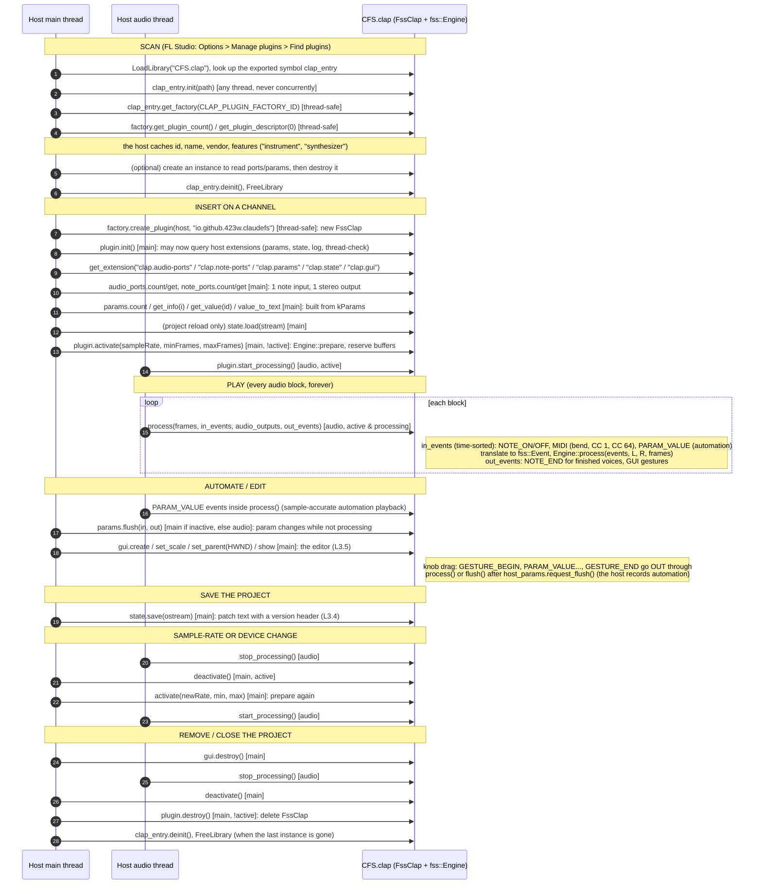

# The host/plugin contract: CFS as a CLAP plugin (L3.1)

What happens between FL Studio and `CFS.clap`, in order, and **which thread each call runs on**. Every
call below is a real function in the CLAP 1.2 headers (`[CLAP]`, pinned at 1.2.10 in `hosts/clap/`).
The thread tags are copied from those header comments, which are the spec.

> Three threads matter (a host may use more, but each call is tagged with one of these roles):
> - **main**: the host's UI thread. Scanning, creating, parameter *info*, state, GUI. Slow work is allowed here.
> - **audio**: the thread that calls `process()`. Hard real time: `docs/RT-RULES.md` applies, no exceptions.
> - **any / thread-safe**: may be called from any thread, sometimes concurrently (factory queries, `get_extension`).

## 1. The sequence

Two things the diagram can't show well:

- **Activation is repeatable.** `activate → deactivate` may happen many times in one instance's life (sample
  rate changes, FL Studio's "smart disable"). Everything sized by the sample rate or block size is set up in
  `activate`, never in `create`.
- **`process()` is the only door to the audio thread.** The host never "sets a parameter" on the audio
  thread with a function call. Changes arrive as *events inside `process()`* (or `flush()`). That is the
  answer to L3.1's [THINK] (see the journal, `docs/journal/L3.1.md`).

## 2. Who owns what, and how CFS crosses threads

| Data | Written by | Read by | How CFS shares it |
|---|---|---|---|
| `fss::Engine` (voices, the audio-side `Patch`) | audio thread (`process`, `flush` while active) | audio thread | Nobody else touches it. When **inactive**, the main thread owns it (no audio thread exists). |
| Main-thread `Patch` mirror | main thread | `get_value`, `state.save`, the GUI | Kept current by draining an audio→main SPSC queue of "param changed" messages (host automation). |
| GUI edits (value + gesture begin/end) | main thread | audio thread | A main→audio SPSC queue; the audio side turns them into Engine `ParamChange` events *and* `out_events` for the host. Same pattern as fss_play (D11). |
| Meters (voices, peak) | audio thread | GUI | `std::atomic` values, polled by the editor's ~60 Hz timer. |
| State load while playing | main thread | audio thread | The main thread updates its mirror and queues one `ParamChange` per parameter; the Engine applies them at the next block. |

No locks anywhere on the audio path. The queues are `fss::util::SpscQueue` (L2.3): single producer,
single consumer. Where a queue's consumer can be "audio thread while active, main thread while inactive",
the host's own activate/deactivate calls order the two, so there is still only one consumer at a time.

## 3. What a CLAP host may throw at `process()` (the L3.2 [THINK])

| Case | What CFS does |
|---|---|
| `frames_count == 0` | Apply the events (the Engine handles a 0-frame block: everything lands "at the end"), write nothing. |
| More frames than `maxFrames` from `activate` | Never allowed by the spec, but harmless: CFS renders in chunks of its scratch size. |
| Events but no audio buffers (or a 0-channel port) | Render into internal scratch and throw it away, so notes and params still advance time correctly. |
| More events in one block than the scratch list holds | Render up to the event that didn't fit, then continue with a fresh list (exact, thanks to block-size invariance). |
| Non-finite output (a bug) | Never reaches the host: the block is zeroed and the voices reset (L6.4). |
